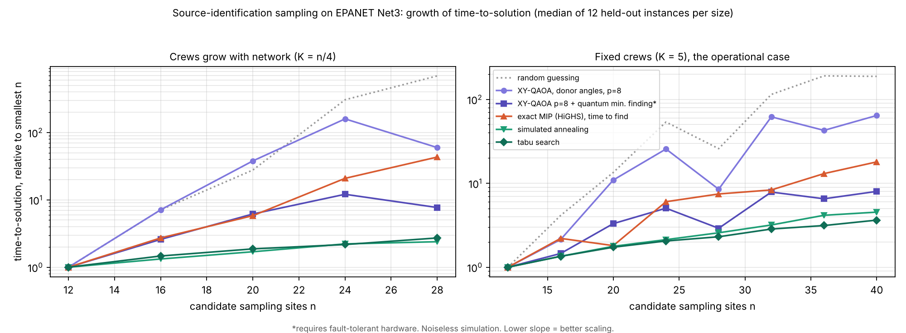

# Quantum vs classical: contamination source-identification sampling

Team 18, NYUAD 2026 quantum hackathon (SDG 6). Independent rebuild, 31 Oct 2026.
Every number below is produced by code in this repo. The advantage test was
pre-registered (`PREREGISTRATION.md`) and committed before any quantum result
existed; the git history shows the order.

## Headline

1. **No quantum advantage over the best classical methods.** Under the
   pre-registered rule, XY-QAOA's time-to-solution does not scale better than
   tabu search, simulated annealing or local search, in either problem family.
2. **The QUBO itself caps any quantum advantage, independent of hardware.**
   A *perfect* QUBO solver still picks worse sampling plans than a 1 ms greedy
   algorithm on the real objective, at every number of crews tested.
3. **A narrower, real result:** noiseless QAOA + quantum minimum finding scales
   better than the exact MIP solver (HiGHS) — the same kind of result as
   Shaydulin et al., *Sci. Adv.* 10, eadm6761 (2024). Strictly significant in
   2 of 3 fit ranges for one family; not significant for the other.
4. **The water impact is real and classical:** 10 grab samples narrow ~367
   candidate sources to 11-15 on a 959-junction network, in half a second.

## What changed from the first study

The first study solved **sensor placement** (where to put detectors). The
judges and Dr. Mousa describe **source identification**: an alarm has fired,
many sources could explain it, and K crews can each take one grab sample.
Judge 6: "v_i and r_ij come from source inversion under uncertainty." This
rebuild solves that problem.

## The problem

1. Contaminant injected at any junction, at an unknown start time (EPANET via WNTR).
2. A monitoring point raises an alarm at time t_A. Every (source, start time)
   scenario that would trigger the same alarm is a candidate, with a probability.
3. Crews sample K sites one hour later. Each sample reads contaminated or clean.
4. Choose K sites so the results best tell the candidate sources apart.

**True objective.** D(A) = probability weight of candidate-source pairs that
plan A tells apart (at least one sampled site reads differently). Pairs with the
same source but different start times don't need separating. D is weighted
coverage, so monotone submodular.

**QUBO.**

```
maximise  sum_i v_i x_i  -  lambda * sum_{i<j} r_ij x_i x_j      subject to  sum_i x_i = K
```

| Symbol | Meaning |
| --- | --- |
| x_i | 1 if a crew samples site i (one qubit per site) |
| K | number of crews |
| v_i | weight of source pairs site i alone tells apart |
| r_ij | weight of source pairs BOTH i and j tell apart (redundancy) |
| lambda | redundancy weight |

At lambda = 1 the QUBO is exactly the second Bonferroni lower bound on D(A),
so lambda = 1 is the principled choice, not a tuned one. All formulas are
checked against literal pair counting (`tests/test_objective.py`).

## Instances

| Network | Junctions | Scenarios | Alarm events |
| --- | --- | --- | --- |
| EPANET Net3 | 92 | 552 (92 sources x 6 start times) | 379 with >= 20 candidate sources |
| ky4 | 959 | 2,877 (959 x 3) | 1,455 with >= 100 candidate sources |

Real Net3 events: up to 55 candidate sources and 74 informative sampling sites.
QAOA angles are trained on 113 events and tested on 266 different ones.

## Result 1: the pre-registered advantage test

Time-to-solution (TTS) scaling, 12 held-out instances per size. Quantum TTS =
1/P(optimum) shots (Shaydulin et al.); classical TTS = seconds to first exact
optimum with restarts. Only scaling bases are compared (units differ).

| Method | F1: K = n/4, n = 12-28 | F2: K = 5, n = 12-40 |
| --- | --- | --- |
| Random guessing | 1.524 [1.453, 1.627] | 1.201 [1.144, 1.242] |
| XY-QAOA, donor angles, p = 8 | 1.326 [1.214, 1.450] | 1.154 [1.116, 1.226] |
| XY-QAOA p = 8 + quantum min. finding* | 1.151 [1.100, 1.200] | 1.074 [1.057, 1.106] |
| Exact MIP (HiGHS), time to find | 1.270 [1.207, 1.326] | 1.106 [1.076, 1.129] |
| Simulated annealing | 1.058 [1.050, 1.068] | 1.055 [1.047, 1.067] |
| Tabu search | 1.062 [1.057, 1.074] | 1.045 [1.040, 1.050] |
| Random-restart local search | 1.048 [1.036, 1.072] | 1.026 [1.013, 1.039] |

\*Needs fault-tolerant hardware. Bases with 95% bootstrap CIs.

**Decision: no evidence of advantage, both families, every fit range.** Tabu
search found the exact optimum on 96-100% of runs at every size.



**Robustness of the QMF-vs-MIP result** (`experiments/e3e_robustness.py`): QAOA +
QMF's point estimate is below MIP's in all 6 fit ranges. CIs separate strictly
in F1 for n = 12-28 and 20-28, not for 16-28 (1.198 vs 1.185), and never in F2.
The F1 QAOA curve dips at n = 28 because tied optimal plans jump from 7 to 27;
that flatters the small-range fits and should not be read as a trend.

**Hardware noise** (global depolarising model, sourced error rates):

| Instance | p | 2-qubit gates | P(opt) ideal | Helios (7.9e-4) | Heron (3e-3) | Random guessing |
| --- | --- | --- | --- | --- | --- | --- |
| F1 n=28, K=7 | 4 | 1,736 | 9.1e-4 | 2.3e-4 | 5.0e-6 | 2.3e-5 |
| F1 n=28, K=7 | 8 | 3,472 | 3.0e-3 | 1.9e-4 | 1.9e-7 | 2.3e-5 |
| F2 n=40, K=5 | 4 | 3,440 | 6.6e-4 | 4.4e-5 | 2.2e-8 | 4.3e-5 |

On the best device the effect survives at p = 4 (10x random). On IBM Heron,
noise pushes it below random guessing. Gate counts exclude Dicke-state
preparation and assume all-to-all connectivity, so they are lower bounds.

## Result 2: the QUBO caps quantum advantage

Net3, 15 held-out events, every informative site, exact true optimum by MIP
(cross-checked against Chama: 18/18 identical optima). Fraction of the true
optimum reached:

| Plan chosen by | K = 3 | K = 5 | K = 10 |
| --- | --- | --- | --- |
| Greedy on the true objective (~1 ms) | **99.1%** | **99.3%** | **99.8%** |
| Perfect QUBO solver, lambda = 0.25 | 93.2% | 95.6% | 99.1% |
| Perfect QUBO solver, lambda = 0.5 | 98.2% | 98.7% | 96.0% |
| Perfect QUBO solver, lambda = 1 (Bonferroni) | 95.5% | 90.9% | 88.3% |
| Naive top-K ranking by v_i | 77.0% | 80.6% | 88.6% |

A quantum device that solved the QUBO perfectly would still choose worse plans
than greedy, at every K. The pairwise form discards the higher-order overlaps
that greedy uses directly. At lambda = 1 the Bonferroni bound saturates around
K = 4: past that, extra crews add as much penalty as value.

## Result 3: impact KPIs (the three Judge 7 asked for)

**Algorithmic:** the advantage table above.

**SDG 6 — narrowing the candidate sources (Net3, mean of 15 events, 24.6 candidates):**

| Crews | Optimal plan | Random sites | Top-K ranking | P(source identified), optimal vs random |
| --- | --- | --- | --- | --- |
| 3 | 5.3 left | 11.9 left | 9.8 left | 3.7% vs 3.0% |
| 5 | 3.4 left | 9.1 left | 7.6 left | 15.2% vs 6.4% |
| 10 | 2.3 left | 6.0 left | 5.0 left | 43.6% vs 15.2% |

**Operations / sustainability — field inspections avoided per event:** with 5
crews, 24.6 candidate locations shrink to 3.4: about 21 inspections avoided,
and 5.7 fewer than sampling random sites.

**At Dr. Mousa's scale (ky4, 959 junctions):**

| Alarm | Candidate sources | Sites | K | Greedy | Certified | Exact MIP (120 s) | Sources left |
| --- | --- | --- | --- | --- | --- | --- | --- |
| J-252 | 368 | 498 | 5 / 10 | 0.51 / 0.65 s | >= 90.2% / 96.3% | not proven, worse than greedy | 36.5 / 13.7 |
| J-257 | 367 | 559 | 5 / 10 | 0.49 / 0.54 s | >= 92.1% / 96.3% | not proven, worse than greedy | 37.2 / 14.9 |
| J-249 | 366 | 432 | 5 / 10 | 0.41 / 0.52 s | >= 90.2% / 96.8% | not proven, worse than greedy | 28.0 / 11.0 |

"Certified" uses the submodular online bound of Krause et al. (2008), a proof
the plan is within that fraction of optimal. The quantum version would need
432-559 qubits (Helios has 98, Heron 156, the Zephyr clique limit is below 232)
and 94,000-157,000 two-qubit gates at p = 1.

## Deviations from the pre-registration

1. F1 trained QAOA angles on n in {8, 12, 16}, because K = n/4 needs n divisible by 4.
2. Angles were sign-normalised before averaging: (gamma, beta) and (-gamma, -beta)
   give identical outputs, and averaging mirror copies cancelled them.
3. Averaged angles failed even on training instances (beta spread ~1.4 rad).
   Added the best single "donor" training solution as the fixed-angle method.
   This change helps the quantum side; both are reported.
4. Exact MIP time-to-find added alongside time-to-prove, matching Shaydulin et al.

## Limitations

- Noiseless simulation up to 28-40 qubits; scaling fits from 5-8 sizes.
- HiGHS, not Gurobi. Gurobi is usually faster, which would strengthen the classical side.
- Binary grab samples, uniform priors, one alarm, one sampling round.
- Classical wall-clock is Python; SA and tabu also reported in operation counts.

## Reproduce

```bash
pip install -r requirements.txt
python tests/test_objective.py && python tests/test_quantum.py
python experiments/e0_scenarios.py Net3 && python experiments/e0_scenarios.py ky4
python experiments/e3a_train_angles.py && python experiments/e3a2_medoid.py
python experiments/e3b_quantum.py F1 && python experiments/e3b_quantum.py F2
python experiments/e3c_classical.py F1 && python experiments/e3c_classical.py F2
python experiments/e3d_fit.py && python experiments/e3e_robustness.py
python experiments/e2_operational.py && python experiments/e4_large.py
```

## Sources

- Shaydulin et al., Evidence of scaling advantage for QAOA on a classically intractable problem, *Sci. Adv.* 10, eadm6761 (2024), [arXiv:2308.02342](https://arxiv.org/abs/2308.02342)
- Hadfield et al., From QAOA to a Quantum Alternating Operator Ansatz, *Algorithms* 12, 34 (2019), [arXiv:1709.03489](https://arxiv.org/abs/1709.03489)
- Wang, Rubin, Dominy & Rieffel, XY mixers for QAOA, *PRA* 101, 012320 (2020), [arXiv:1904.09314](https://arxiv.org/abs/1904.09314)
- Bärtschi & Eidenbenz, Deterministic preparation of Dicke states (2019), [arXiv:1904.07358](https://arxiv.org/abs/1904.07358)
- Zhou et al., QAOA performance, mechanism and implementation, *PRX* 10, 021067 (2020)
- Babbush et al., Focus beyond quadratic speedups for error-corrected quantum advantage, *PRX Quantum* 2, 010103 (2021), [arXiv:2011.04149](https://arxiv.org/abs/2011.04149)
- Krause et al., Efficient sensor placement optimization for securing large water distribution networks, *JWRPM* 134(6), 516 (2008)
- Nemhauser, Wolsey & Fisher, *Math. Program.* 14, 265 (1978)
- Quantinuum, H1-1 two-qubit fidelity 99.914% (Apr 2024) and Helios 99.921% average, 98 qubits, [quantinuum.com](https://www.quantinuum.com/blog/quantinuum-extends-its-significant-lead-in-quantum-computing-achieving-historic-milestones-for-hardware-fidelity-and-quantum-volume)
- IBM Heron median two-qubit error ~3e-3, 156 qubits, [postquantum.com](https://postquantum.com/industry-news/ibm-heron-r2-quantum/)
- D-Wave Advantage2: 4,400+ qubits, Zephyr, 20-way connectivity (May 2025), [Business Wire](https://www.businesswire.com/news/home/20250520948155/en/)
- Boothby et al., Zephyr topology: cliques up to K_{16m-8}, [D-Wave report 14-1056A-A](https://www.dwavequantum.com/media/fawfas04/14-1056a-a_zephyr_topology_of_d-wave_quantum_processors.pdf)
- Klise et al., WNTR User Manual v1.0, US EPA (2023); Chama, Sandia National Laboratories
